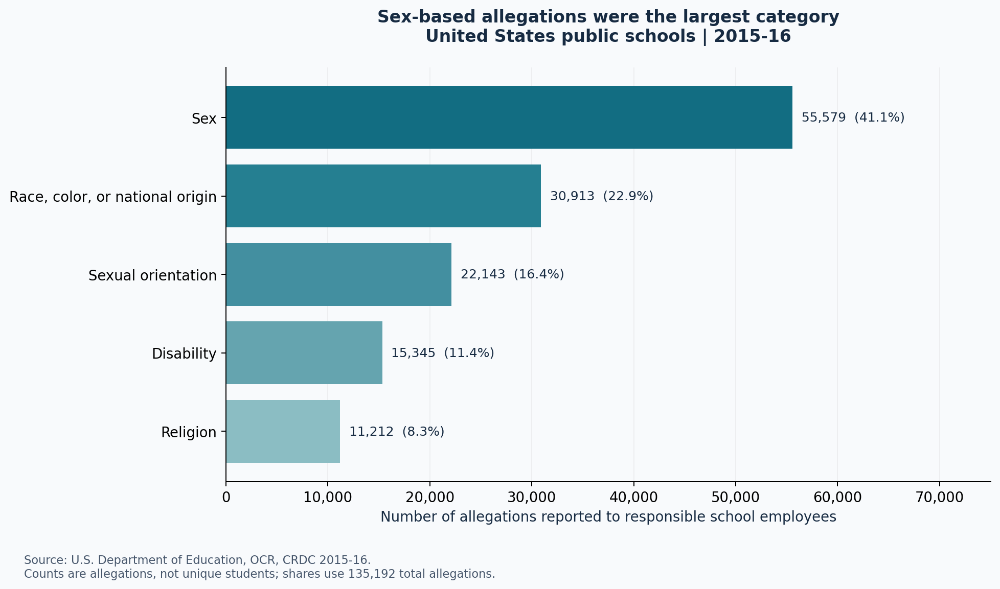
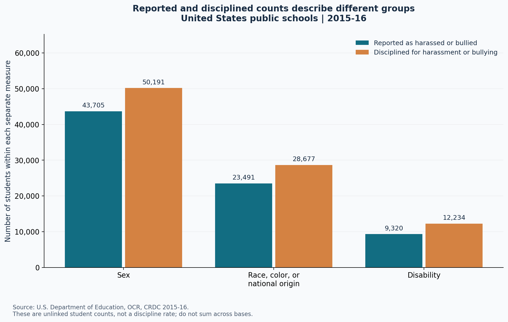

# Analysis results: harassment and bullying, 2015-16

Research question: How did reported harassment and bullying vary by basis, and how did the sex composition of reported students differ?

## Findings

- The national table contains **135,192 allegations**. Sex-based allegations account for **55,579 (41.1%)**, the largest category.
- Reported student counts are **43,705** for sex-based, **23,491** for race/color/national-origin-based, and **9,320** for disability-based bullying. Categories must not be added to estimate unique students.
- Female students make up **63.9%** of sex-based reported students. Male students make up **63.5%** of race-based and **66.9%** of disability-based reported students. These are within-category shares, not risk estimates.

## Visual evidence

## Interpretation and limitations

This is descriptive analysis of historical administrative reports. Reporting practices, coverage, school size and underreporting can affect counts. Enrollment denominators are not included, so this analysis cannot measure prevalence, compare population risks or infer causation. Reported victims and disciplined students are different, unlinked groups; their ratio is not a case-resolution rate. People may occur in more than one basis category. Sex categories reproduce the source's Male and Female sheets and do not represent all gender identities.

The national allegations table reports 99.5% of schools reporting. District of Columbia coverage is below 85% in that table and is flagged in the cleaned data. National source totals are retained rather than replacing missing reports with zero.

## Reproducibility

Validation passed for all 19 sheets: 50 states, DC and a separate national row; nonnegative integer counts; national/state reconciliation; Male + Female = Total; and allegation-category reconciliation. See `validation.json`, `input_audit.json` and `tables/` for evidence. Checks validate internal consistency, not the accuracy of the original school reports.

Data source: [U.S. Department of Education, Office for Civil Rights, CRDC 2015-16](https://catalog.data.gov/dataset/2015-16-harassment-or-bullying-by-basis-category-civil-rights-data-collection). Figures and tables were derived from the seven supplied Excel files without modifying them.
